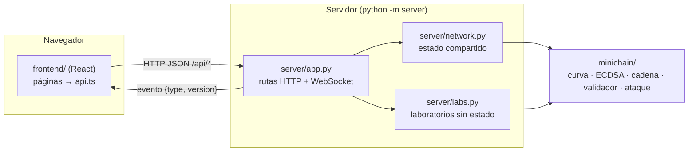

# Cómo se conecta la UI con la simulación

Guía corta para entender el flujo de datos y extenderlo. Si solo quieres
ejecutar el proyecto, ve a la sección [Ejecutar](../README.md#ejecutar) del README.

## La idea en una figura



Hay tres capas, y cada una solo conoce a la de abajo:

| Capa | Carpeta | Responsabilidad | Sabe de HTTP |
|---|---|---|---|
| Núcleo | `minichain/` | Toda la criptografía y la cadena. Python puro, sin dependencias. | No |
| Servidor | `server/` | Traduce el núcleo a JSON, guarda el estado compartido y avisa de cambios. | Sí |
| UI | `frontend/` | Muestra el estado y llama a la API. No hace criptografía. | Solo por `api.ts` |

Por eso la demo de terminal (`python -m minichain`) y la UI usan exactamente el
mismo código: el servidor no reimplementa nada, solo llama a `minichain`.

## El recorrido de una acción

Ejemplo: alguien pulsa **Transferir** en el encabezado y luego **Firmar y enviar**.

1. `frontend/src/components/dialogs.tsx` llama a `api.transfer("Alice", "Bob", 10, "")`.
2. `frontend/src/api.ts` hace `POST /api/transactions/transfer` con JSON.
3. `server/app.py` valida el cuerpo con Pydantic (`TransferRequest`) y llama a
   `Network.transfer` en un hilo aparte (para no bloquear el servidor).
4. `server/network.py` crea la transacción con `minichain.block.Transaction.create`,
   que firma con ECDSA usando la estrategia de nonce de la billetera, y la manda a
   la mempool del `minichain.node.Node`, que la valida contra el saldo pendiente.
5. El servidor publica `{"type": "mempool", "version": 7}` por el WebSocket a todos
   los clientes conectados.
6. Cada navegador (`frontend/src/store.tsx`) recibe el evento, ve que la versión
   cambió y vuelve a pedir `GET /api/state` (y repite el análisis de firmas para
   las alertas). Todas las pantallas se actualizan.

El protocolo en tiempo real es mínimo a propósito: los eventos solo dicen *qué
cambió*; los datos siempre se piden por HTTP. Así no hay dos fuentes de verdad.

## Reglas del JSON

- Los enteros de 256 bits (claves, r, s, z, k, hashes) viajan como **cadenas
  hexadecimales de 64 caracteres**. JavaScript no representa con exactitud
  números mayores que 2⁵³.
- Los puntos de curvas pequeñas viajan como `[x, y]`; el punto en el infinito es `null`.
- Los errores responden `{"detail": "mensaje"}` con código 400 (petición inválida)
  o 404 (no existe). La UI muestra `detail` como aviso.

## Endpoints

La referencia completa, con esquemas y un botón para probar cada llamada, está en
**http://localhost:8000/api/docs** con el servidor encendido.

Rol: **público** = cualquiera con la URL; **admin** = requiere el token
(`Authorization: Bearer <MINICHAIN_ADMIN_TOKEN>`, ver [Roles](#roles)); **límite** =
público con límite de peticiones por IP.

| Método | Ruta | Rol | Para qué |
|---|---|---|---|
| GET | `/api/health` | público | Estado del servidor, del almacenamiento y del rol de quien pregunta |
| GET | `/api/state` | público | Billeteras, mempool, resumen de bloques, parámetros, rol |
| GET | `/api/admin/check` | admin | Comprobar un token |
| POST | `/api/reset` | admin | Regenerar el escenario (semilla, dificultad, nonce de Bob…) |
| GET | `/api/search?q=` | público | Búsqueda global: bloque, txid, billetera o dirección |
| GET | `/api/blocks/{i}` | público | Bloque con transacciones y niveles del árbol de Merkle |
| GET | `/api/blocks/{i}/proof/{tx}` | público | Prueba de inclusión Merkle |
| GET | `/api/chain/export` | público | Cadena completa en JSON |
| GET | `/api/transactions` | público | Transacciones confirmadas (filtro opcional `?address=`) |
| GET | `/api/transactions/{txid}` | público | Una transacción con su bloque y prueba Merkle |
| GET | `/api/wallets/{nombre}` | público | Billetera con su historial |
| POST | `/api/wallets` | admin | Crear una billetera custodiada por el servidor |
| PUT | `/api/wallets/{nombre}/nonce` | admin | Cambiar su estrategia de nonce |
| POST | `/api/transactions/transfer` | admin | El servidor firma con una billetera custodiada |
| POST | `/api/transactions` | **límite** | Enviar una transacción firmada por el cliente: la firma es la autorización |
| POST | `/api/mine` | admin | Minar un bloque con la mempool |
| GET | `/api/validate` | público | Validar la cadena real (en caché) |
| POST | `/api/tamper` | admin | Manipular una copia y validarla |
| POST | `/api/validate/external` | admin | Validar una cadena en JSON |
| GET | `/api/attack/scan` | público | Buscar r repetidos y recuperar claves (en caché) |
| POST | `/api/attack/steal` | admin | Firmar como la víctima y minar |
| POST | `/api/defense/compare` | admin | Comparar RNG defectuoso contra RFC 6979 |
| GET/POST | `/api/lab/...` | límite | Curva de juguete, double-and-add, firma y verificación paso a paso |
| WS | `/api/events` | público | Eventos `{type, version}`: `reset`, `wallet`, `mempool`, `block`, `presence` |

### Roles

| Rol | Quién | Qué puede hacer |
|---|---|---|
| **Público** | Cualquiera con la URL | Leer todo (la cadena es pública), usar los laboratorios y enviar transacciones **firmadas con su propia clave**. |
| **Administrador** | Quien tiene `MINICHAIN_ADMIN_TOKEN` | Además: regenerar la red, firmar con las billeteras de la simulación (Alice, Bob…), minar, manipular copias de la cadena, validar archivos, comparar estrategias y ejecutar la explotación. |

- Sin `MINICHAIN_ADMIN_TOKEN` el servidor está en **modo abierto**: todos son
  administradores. Sirve para desarrollo local; en una URL pública hay que
  definirlo siempre. El servidor lo advierte en el registro, y la interfaz muestra
  "modo abierto" en el encabezado.
- El token se compara en tiempo constante y viaja en el encabezado
  `Authorization`, nunca en la URL.
- El análisis de firmas, incluida la clave recuperada, es público a propósito:
  cualquiera puede calcularla con los datos de la cadena, así que ocultarla en la
  API no protegería nada.
- Las escrituras públicas tienen un límite por IP (`MINICHAIN_RATE_LIMIT`, 60 por
  minuto por defecto). El administrador no tiene límite.

## Usar la simulación sin la UI

Cualquier programa puede ser un cliente. Con `curl`:

```bash
curl -s localhost:8000/api/state | python -m json.tool | head -30
curl -s -X POST localhost:8000/api/transactions/transfer \
     -H 'Content-Type: application/json' \
     -d '{"sender": "Alice", "recipient": "Bob", "amount": 5}'
curl -s -X POST localhost:8000/api/mine -H 'Content-Type: application/json' -d '{"miner": "Alice"}'
curl -s localhost:8000/api/attack/scan | python -m json.tool | head -40
```

Un cliente con **su propia clave**, que el servidor nunca ve (así funcionaría una
billetera real):

```python
import json, urllib.request
from minichain.block import Transaction
from minichain.wallet import Wallet

API = "http://localhost:8000"

def call(method, path, body=None):
    req = urllib.request.Request(API + path, method=method,
                                 data=None if body is None else json.dumps(body).encode(),
                                 headers={"Content-Type": "application/json"})
    return json.load(urllib.request.urlopen(req))

me = Wallet.generate("yo")                               # clave local
call("POST", "/api/mine", {"miner": me.address})          # cobro 50 de recompensa
alice = next(w for w in call("GET", "/api/state")["wallets"] if w["name"] == "Alice")
tx = Transaction.create(me, alice["address"], 20, seq=0, memo="firmado en mi máquina")
print(call("POST", "/api/transactions", tx.to_dict()))    # el servidor solo verifica
```

## Agregar una funcionalidad nueva

Ejemplo: mostrar cuántos bits en cero tiene cada hash de bloque.

1. **Núcleo** (si hace falta matemática nueva): agrega la función en `minichain/`
   con su prueba en `tests/`.
2. **Servidor**: expón el dato. Si es parte del estado, agrégalo en
   `Network.block_summary` (`server/network.py`). Si es una acción nueva, crea un
   método en `Network` y una ruta en `create_app` (`server/app.py`), y si cambia el
   estado, llama a `await changed("tipo")` para avisar a los clientes.
3. **Tipos**: refleja el campo en `frontend/src/types.ts`.
4. **Cliente**: si es una ruta nueva, una línea en `frontend/src/api.ts`.
5. **UI**: úsalo en la página. Para una página nueva, crea
   `frontend/src/pages/MiPagina.tsx`, regístrala en `PAGES` (`frontend/src/App.tsx`) y
   agrega su entrada al grupo que corresponda en `NAV` (`frontend/src/components/shell.tsx`).
6. **Prueba**: un caso en `tests/test_server.py` con `TestClient`.

## Variables de entorno

| Variable | Por defecto | Uso |
|---|---|---|
| `MINICHAIN_HOST` | `127.0.0.1` | `0.0.0.0` para aceptar conexiones de otras máquinas |
| `PORT` o `MINICHAIN_PORT` | `8000` | Puerto del servidor (Render asigna `PORT`) |
| `DATABASE_URL` | vacío | PostgreSQL donde se guarda la red (Supabase, *session pooler*) |
| `MINICHAIN_STATE_FILE` | vacío | Alternativa local: guardar la red en un archivo JSON |
| `MINICHAIN_ADMIN_TOKEN` | vacío | Token del administrador. Vacío = modo abierto (solo desarrollo) |
| `MINICHAIN_RATE_LIMIT` | `60` | Escrituras públicas por minuto y por IP (0 = sin límite) |
| `FORWARDED_ALLOW_IPS` | `127.0.0.1` | Proxies de los que se acepta `X-Forwarded-For` (en el Dockerfile: `*`, para Render) |
| `MINICHAIN_SEED` | `2026` | Semilla del escenario inicial |
| `MINICHAIN_DIFFICULTY` | `14` | Dificultad inicial (bits) |
| `MINICHAIN_MAX_DIFFICULTY` | `22` | Máximo por bloque, para que nadie bloquee el servidor |
| `MINICHAIN_CORS` | `http://localhost:5173,…` | Orígenes permitidos si la UI vive en otro dominio |
| `MINICHAIN_FRONTEND_DIST` | `frontend/dist` | UI compilada que se sirve en `/` |
| `VITE_API_URL` (UI) | vacío | URL de la API si no está en el mismo origen |
| `MINICHAIN_API` (UI, dev) | `http://127.0.0.1:8000` | A dónde reenvía Vite en `npm run dev` |
